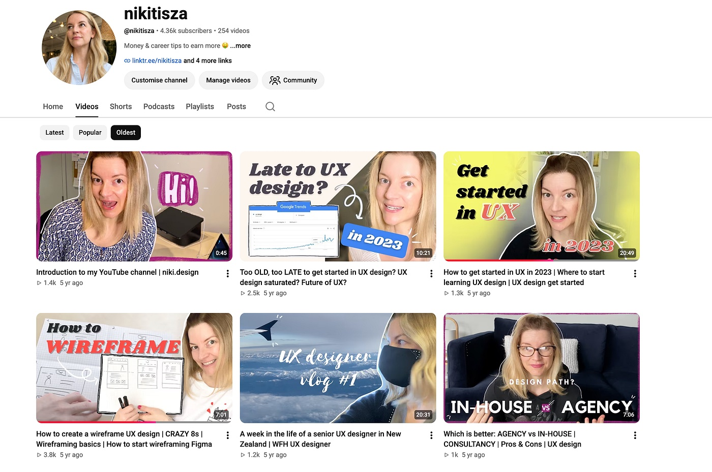

<figure style="padding-bottom:33.723653395784545%" class="w-richtext-align-normal w-richtext-figure-type-video">
<iframe src="https://www.youtube.com/embed/eIk9vX5QZC8" title="Please don’t subscribe (I need something else)" scrolling="no" frameborder="0" allowfullscreen="true"></iframe>
</figure>

Please don’t subscribe to my channel.

Seriously.

I don’t need subscribers. I need something else, and I have until February 1st to get it.

I’ve been making YouTube videos for over five years. Mostly educational stuff: UX design, UX research, careers in tech.

<figure class="w-richtext-align-normal">

</figure>

Recently I’ve branched out into money, lifestyle and starting over in my 40s.

I have over 4,000 subscribers.

But I’m not monetized.

Because to get into the YouTube Partner Program, subscribers aren’t the hard part.

Watch hours are.

You need 4,000 hours in 12 months. My best year ever? Just under 3,000.

None of my videos ever went viral. And honestly, I still don’t know why. But it is what it is.

### But here’s why I’m asking for help right now.

On February 1st, YouTube doubles the requirement to 8,000 watch hours a year.

For a channel like mine, that’s basically out of reach. But anyone who gets in before that date keeps their spot.

So this is my window. 4,000 hours before February 1st.

### Here’s my ask

So instead of subscribing, watch.

Pick a video that’s actually useful to you.

👉 Learning UX & product design? Start here:

<figure style="padding-bottom:33.723653395784545%" class="w-richtext-align-normal w-richtext-figure-type-video">
<iframe src="https://www.youtube.com/embed/7VPZDTWKP78" title="Too OLD, too LATE to get started in UX design? UX design saturated? Future of UX?" scrolling="no" frameborder="0" allowfullscreen="true"></iframe>
</figure>

👉 Job hunting in tech? Start here:

<figure style="padding-bottom:33.723653395784545%" class="w-richtext-align-normal w-richtext-figure-type-video">
<iframe src="https://www.youtube.com/embed/yO6RP7UKM5s" title="How to be a 10x designer? Are you a 10x designer? ONE thing you need to do to be a better designer." scrolling="no" frameborder="0" allowfullscreen="true"></iframe>
</figure>

👉 Want only podcastable design videos to listen to? Start here:

<figure style="padding-bottom:33.723653395784545%" class="w-richtext-align-normal w-richtext-figure-type-video">
<iframe src="https://www.youtube.com/embed/ZHr81Z90xoc" title="How to run effective meetings as a designer – 4P method for meeting mastery" scrolling="no" frameborder="0" allowfullscreen="true"></iframe>
</figure>

Watch it all the way through. That’s it.

That’s the whole favour.

Funny story: When I asked for this on LinkedIn, I got over 15 messages from people offering to sell me views. One even sent me a heat map of how “natural” it would look. I’m not doing it. Fake views can get a channel banned, and honestly, that’s not why I started this.

I’ll keep making videos either way. I love this. It’s been a labour of love for 5 years. But even $50 or $100 a month from it would feel like this channel finally paid me back a little.

So don’t subscribe.

Watch.
