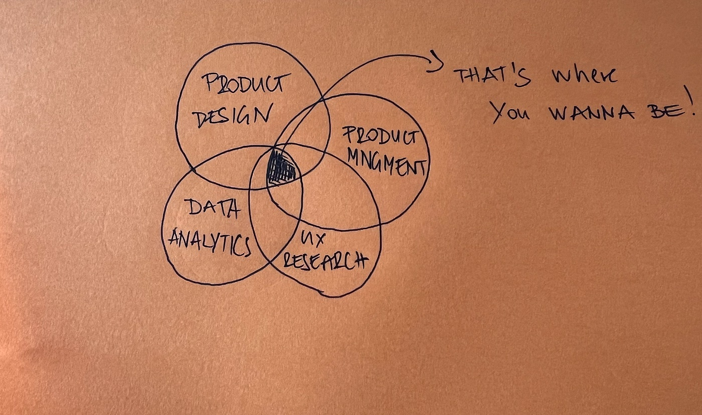

<figure class="w-richtext-align-normal">

<figcaption>Image by the author</figcaption></figure>

I’ve led design teams for over a decade, across Europe, New Zealand and North America. I came into design from banking, which means I’ve always looked at our profession with one eye on the money.

And right now, the money is telling us something we don’t want to hear.

### The numbers

Lenny’s Newsletter just published its [State of the Tech Job Market](https://www.lennysnewsletter.com/p/state-of-the-tech-job-market-late) report, using TrueUp data on open roles at tech companies from January 2023 to October 2026. Here’s the short version:

- Product management roles: up 56%
- Software engineering: up 43%
- Data and analytics: up 18%
- Product design: down 22%
- UX research: down 55%, with only 116 open roles

Same companies.

Same three years.

Product management is booming, and design is shrinking.

UX research, as a standalone job title, is nearly gone.

The easy explanation is AI.

But, I think it’s also the wrong one.

If you look at the chart in the [report](https://www.lennysnewsletter.com/p/state-of-the-tech-job-market-late), the lines start separating in 2024, before generative AI was anywhere near a designer’s daily workflow. Something else happened first.

### The self-inflicted wound

Here’s what I think happened, and I say this as someone who was part of it:

1 — Over the last decade, we rebranded ourselves as “product designers” and quietly narrowed our job to screens.

2 — We got embedded in agile teams, one designer per squad, taking Jira tickets.

3 — We poured our energy into design systems and talked endlessly about craft. We measured our value by the quality of our mockups.

4 — Meanwhile, product management absorbed everything else. Talking to customers. Discovery. Connecting the work to revenue. Deciding what gets built and why.

That used to be the heart of UX.

We handed it over, often without noticing, because it didn’t look like “design.”

Then AI arrived and took the one thing we’d kept: the screens.

We gave up the strategic work and then automated the tactical work. There is not much left to hire for right now.

### What design is actually for in 2027

I don’t think this is the end of the profession. But I think it’s the end of a narrow version of it.

If everyone can generate a prototype, output stops being scarce.

What becomes scarce is:

- knowing which problem is worth solving
- holding the whole experience together across an increasingly complicated product, and
- getting a room full of people to agree on what good looks like.

That’s a T-shaped designer.

Deep in design, but fluent in research, data analysis, and product thinking.

### Here’s what I’d tell anyone who wants to still have a design job in 2027

#### 1 — Stop defining yourself by artifacts

Nobody is paying a premium for mockups anymore. Your value is the decision behind the mockup, and whether you can explain it.

#### 2 — Get closer to the money

Learn churn, retention, customer lifetime value.

Understand how your product makes revenue and talk about your work in those terms.

#### 3 — Master facilitation

The most underrated design skill is running a room. Aligning stakeholders, surfacing disagreement, driving a decision.

The designers who got promoted on my teams were never the best Figma users. They were the best in the room.

#### 4 — Absorb research tasks

If you’re a specialist (UX researcher), especially in qualitative research, add quantitative and data analysis skills now.

Companies are pulling research inside product and design teams instead of keeping it as a separate function. Your skills aren’t dead, but your job title might be.

### The opportunity

Most companies default to “what is design for?” and say screens.

Demonstrating our value within that default only reinforces it.

So, here’s our opportunity: to step back and redefine the practice, with intent this time, as strategic product leadership that happens to be very good at design.

I made a full video walking through the data and what to do about it. You can watch it here:

<figure style="padding-bottom:33.723653395784545%" class="w-richtext-align-normal w-richtext-figure-type-video">
<iframe src="https://www.youtube.com/embed/ejly_C9iqQQ" title="UX jobs are down 22%. Did we do this to ourselves?" scrolling="no" frameborder="0" allowfullscreen="true"></iframe>
</figure>

<strong>👉 [Click to watch the video on YouTube!](https://youtu.be/ejly_C9iqQQ)</strong>

Where do you think design’s value is going? I’d love to hear your number: on a scale of 1 to 10, how hopeful are you about design jobs over the next five years?

And if you’re in the middle of a job search right now, these are the tools I built for myself and still use:

- Job application tracker: [nikitisza.gumroad.com/l/jobapptracker](https://nikitisza.gumroad.com/l/jobapptracker)
- Resume writing kit: [nikitisza.gumroad.com/l/resumewritingkit](https://nikitisza.gumroad.com/l/resumewritingkit)

Read next: [Whiteboard design challenge as part of the design interview process](/writing/whiteboard-design-challenge)
