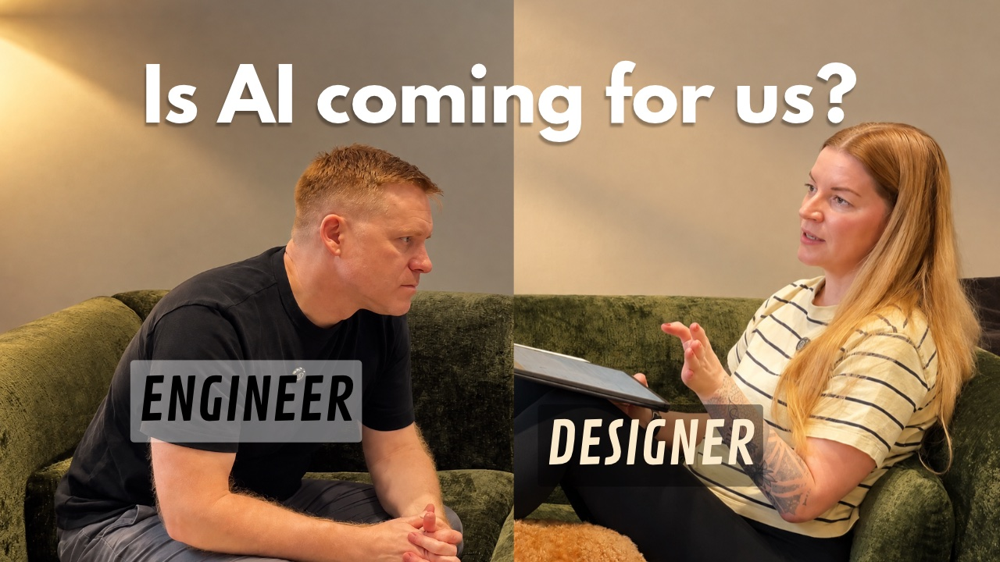

<figure class="w-richtext-align-normal">

<figcaption>Image is by the author</figcaption></figure>

Every week there’s a <strong><em>new headline.</em></strong>

> AI is replacing engineers.
>
> AI is replacing designers.
>
> Hiring is dead.
>
> Learn to code, no wait, don’t.

I’ve been in tech for over 15 years, and I’ve never seen the mood this strange.

People who’ve been laid off are told to *“upskill,”* and people who still have jobs are quietly wondering if they’re next.

So instead of reading another hot take, I sat down with Zoltan, an engineer, and we recorded an honest, unscripted conversation about what we’re actually seeing.

We both use AI every single day, and we see some things differently. Tune into our conversation on YouTube:

<figure style="padding-bottom:33.723653395784545%" class="w-richtext-align-normal w-richtext-figure-type-video">
<iframe src="https://www.youtube.com/embed/-LAjIRKvl5c" title="What AI is really doing to tech jobs (from the inside)" scrolling="no" frameborder="0" allowfullscreen="true"></iframe>
</figure>

<strong>👉 [Click to watch the video on YouTube!](https://youtu.be/-LAjIRKvl5c)</strong>

### What’s in the video?

- We talked about where AI really shows up in our workday, which is less glamorous than LinkedIn would have you believe.
- We talked about the failures, the tasks we tried to hand over and had to take back.
- We talked about whether we’re getting better at our jobs or just faster, and whether “faster” is quietly making a lot of products worse.

Then we got to the uncomfortable part:

- Is AI actually the reason hiring is so tough right now, or is it a convenient excuse?
- Which roles are at risk, and which are safer than people think?
- What would we tell someone who just got laid off?
- And does being in your 40s, with 15 years of experience, help you or hurt you in this market?

There’s one question we completely disagree on. I’m not going to spoil it here, but it’s the part of the conversation I keep thinking about 🤔

If you work in tech, are trying to break in, or just lost your job, this one is for you. The timestamps are in the video description if you want to jump to the question that’s keeping you up at night.

At the end, we each gave a number: on a scale of 1 to 10, how hopeful are you about the next five years in tech?

I’d love your number too.

Leave it in the comments on YouTube.

And if you’re in the middle of a job search right now, these are the tools I built for myself and still use:

- Job application tracker: [nikitisza.gumroad.com/l/jobapptracker](https://nikitisza.gumroad.com/l/jobapptracker)
- Resume writing kit: [nikitisza.gumroad.com/l/resumewritingkit](https://nikitisza.gumroad.com/l/resumewritingkit)

Read next: [Whiteboard design challenge as part of the design interview process](/writing/whiteboard-design-challenge)
